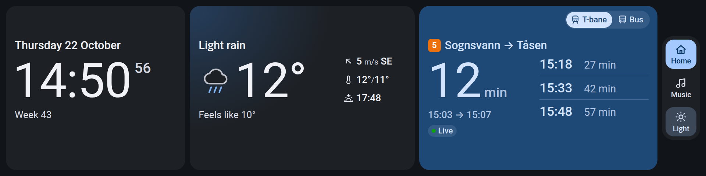
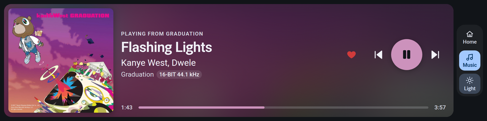
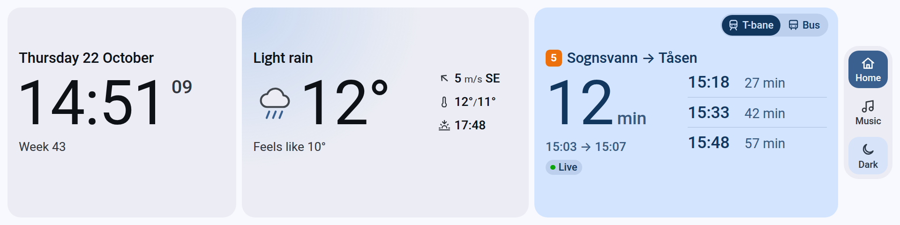
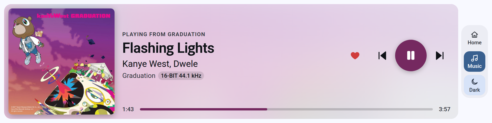
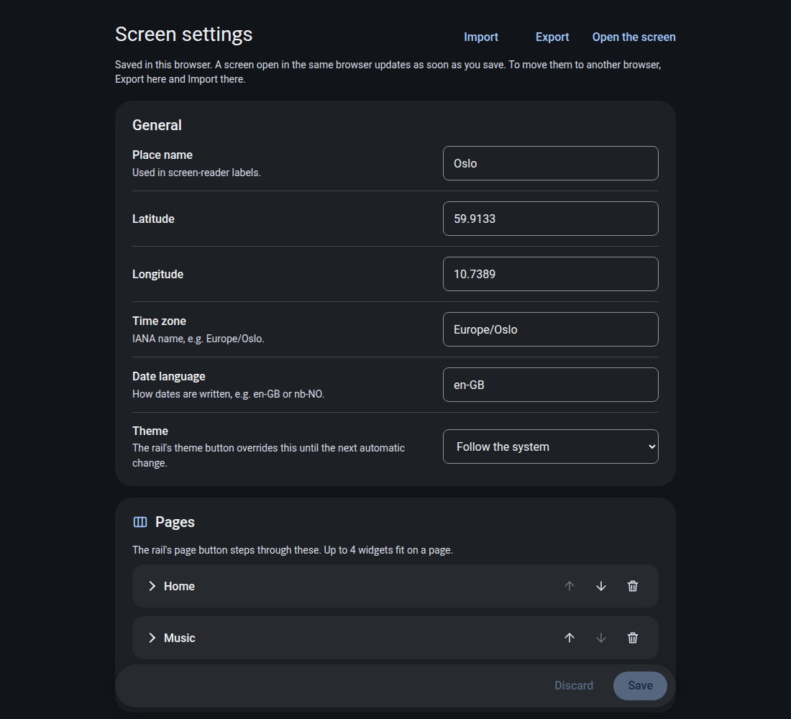
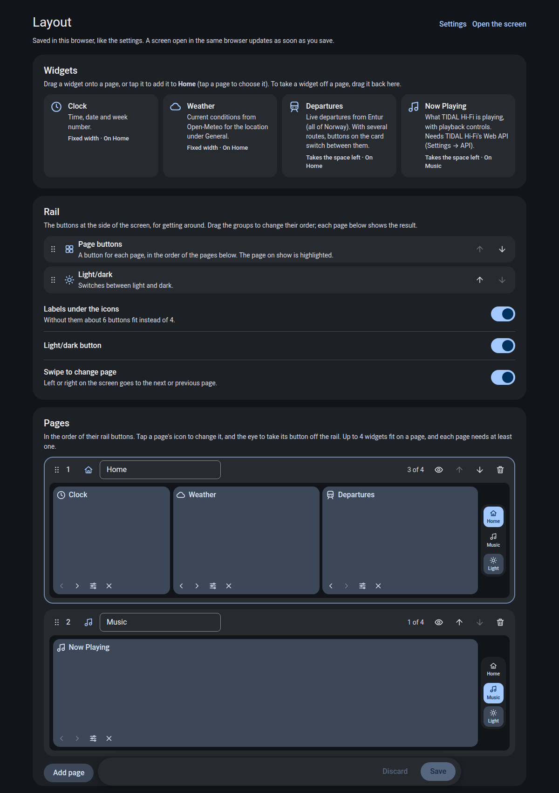

# akp846-app

A web app for the 1920 x 480 touchscreen in the AJAZZ AKP846 keyboard, driven by
[akp846-display](https://github.com/EdyTheCow/akp846-display). It's published
on GitHub Pages, so there is nothing to install or keep running: open the page
on the keyboard's screen and it keeps itself up to date.

- Screen: <https://edythecow.github.io/akp846-app/>
- Settings: <https://edythecow.github.io/akp846-app/settings.html>
- Layout: <https://edythecow.github.io/akp846-app/layout.html>




<details>
<summary>Light theme</summary>




</details>

Widgets so far:

| Widget | |
|---|---|
| Clock | Time, date, week number |
| Weather | Current conditions from [Open-Meteo](https://open-meteo.com/) |
| Departures | Live departures from [Entur](https://developer.entur.org/) (all of Norway), including cancellations and the reason for them |
| Now Playing | What [TIDAL Hi-Fi](https://github.com/Mastermindzh/tidal-hifi) is playing, with album art and playback controls |

Widgets are arranged on pages: by default *Home* (clock, weather, departures)
and *Music* (Now Playing). The rail on the right switches pages and light and
dark; swiping left or right changes page too. When music starts the screen
switches to the music page and goes back after it has been paused for a while.

`first-app.html` is the original single-file version of the Home page. It
still works on its own, straight from disk.

## Settings



Settings are stored in the browser, not on the site. Open the settings page in
the same browser as the screen (on your main monitor, for example): saving
there updates the screen straight away.

To move settings to another browser, use **Export** on the settings page and
**Import** in the other one. An imported file goes into the form first, so you
can check it before you save. The `settings.json` from the old server version
(`~/.config/akp846-screen/settings.json`) imports the same way.

## Pages and widgets



The layout page arranges the screen: which widgets are on which page, in what
order, the order of the pages, and the rail. Each page is drawn to scale, rail
included, as it will look on the keyboard.

- Drag a widget from the library onto a page, or tap it to add it to the
  selected page (tap a page to select it).
- Drag widgets along a page or between pages; drag one back to the library to
  take it off its page.
- Drag a page by its handle to reorder the pages; rename, add and delete them
  in place.
- Every move also has a button, for the keyboard.

A page holds up to 4 widgets and needs at least one; a widget can be on
several pages, but only once on each. There can be up to 6 pages. On a phone,
press and hold a widget to start dragging it.

### The rail

The rail at the side of the screen is for getting around: a button for each
page (the page on show is highlighted) and the light/dark button, in the order
you choose. Controls that belong to a widget are on its card instead, such as
Departures' route buttons.

- Each page has an icon, from a set or *Automatic* (its first widget's), and
  can be left off the rail.
- Labels can be turned off: about 6 buttons fit without them, 4 with them.
  When a page has more buttons than fit with labels, its rail shows icons
  only; the editor says so for each page, and warns when even that won't fit.
- Swiping left or right on the screen goes to the next or previous page. It
  can be turned off.

## On the keyboard (Hyprland)

The screen is the `DVI-I-1` monitor. Open the screen page in a browser window
on it and make it fullscreen. Double-tap toggles fullscreen. The layout is
anchored to the top, because Zen's fullscreen window is 15 px taller than the
screen. A window rule matching the page title, *akp846-app*, can put it there
at login.

URL parameters, useful while testing: `?theme=light|dark`, `?page=1`, and
`?debug` (logs touches on screen).

## Updates and previews

Every push to `main` is published to the site by
[`.github/workflows/publish.yml`](.github/workflows/publish.yml). An open
screen checks for a new version every five minutes and reloads itself when
there is one. It also keeps a copy of the app, so it still starts without
internet (the clock works; weather and departures wait for the connection).

Every pull request from a branch in this repository is published as a preview
at `https://edythecow.github.io/akp846-app/pr/<number>/`, updated on each push
and removed when the pull request closes. The workflow comments the link on the
pull request. A preview's settings start as a copy of the main screen's and are
kept separately, so trying a change can't break the real screen's settings.
Pull requests from forks don't get a preview.

The site is served from the `gh-pages` branch, which the workflow maintains;
don't edit it by hand. In the repository's **Settings → Pages**, the source is
*Deploy from a branch*, `gh-pages`, `/ (root)`.

## TIDAL Hi-Fi

Now Playing talks to TIDAL Hi-Fi's local Web API straight from the browser:

1. In TIDAL Hi-Fi open **Settings → API** and turn on **Web API**. Keep the
   hostname at `127.0.0.1` and the port at `47836`. If you change them, change
   them in the Now Playing settings as well.
2. Turn on **Playback control** too, or the buttons on the screen won't work.
3. The first time, your browser may ask whether the site may connect to
   devices on your local network or this computer. Allow it, or Now Playing
   can't reach TIDAL Hi-Fi.
4. If TIDAL Hi-Fi opens to a blank or grey window, start it with
   `tidal-hifi --no-sandbox`. The AUR package's app-menu entry already does this,
   but a terminal or a Hyprland `exec` doesn't. If startup takes about two
   minutes, turn off its ad blocker (see their
   [known issues](https://github.com/Mastermindzh/tidal-hifi/blob/master/docs/known-issues.md)).

The card takes its colours from the album art. While TIDAL Hi-Fi is still
saving a new track's art it points to TIDAL's own image server instead, which
may not let the page read the colours; the art then shows untinted until the
next check a few seconds later.

## Working on it locally

Needs Node.js 20 or newer; there are no npm packages.

```sh
npm start        # http://127.0.0.1:8846/, /settings.html and /layout.html
npm run check    # syntax check, as the workflow does
```

Settings are per site, so the local copy has its own (Export and Import to
copy them over).

## Files

```
web/                 the published site
  index.html/js      the screen: pages of widgets and the rail
  settings.html/js   the settings page, generated from the schemas
  layout.html/js     the layout editor: pages and their widgets
  sw.js              service worker: network first, offline copy
  core/              shared CSS tokens, helpers, settings storage and schema,
                     sunrise/sunset, theme, update checks, drag and drop
  widgets/<id>/      schema.js (settings), <id>.js (mount), <id>.css
scripts/serve.js     local static server for development
```

## Adding a widget

1. Create `web/widgets/<id>/schema.js`. It exports `{ id, name, description,
   width, icon, settings }`. `width` is in u (1 % of the 440 px base height),
   or `"fill"`. `settings` uses the field types in `web/core/fields.js`:
   toggle, text, number, select, group and list.
2. Create `web/widgets/<id>/<id>.js`. It exports `mount(card, ctx)`, which
   fills in the card and returns `{ destroy() }`. Its controls go on the card;
   the rail is for navigation only. `ctx` provides `settings` (yours, already
   validated), `general`, `fmt` (date and time formatters) and `emit()`.
3. Create `web/widgets/<id>/<id>.css`, with selectors scoped to `.<id>`.
4. Add the schema to `web/widgets/registry.js`.

The widget's settings then appear on the settings page, are validated when
loaded and saved, and the widget can be added to a page.

Mind the USB link: the driver re-encodes every part of the screen that changes,
so avoid continuous animation. Update a few times a second at most.
